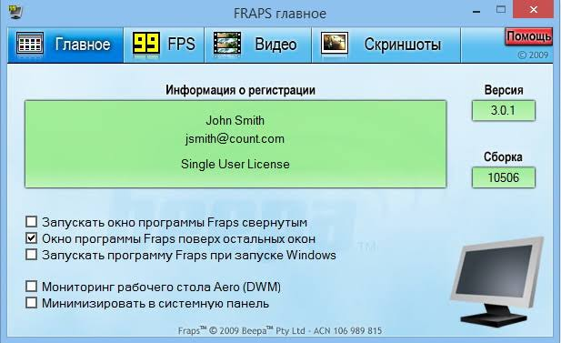
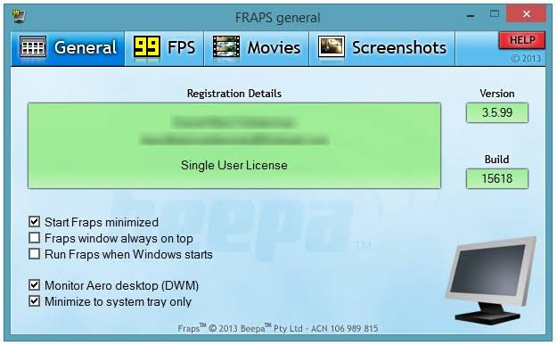

# Fraps for Game Capture and FPS Benchmarking

Fraps is a Windows utility for monitoring frame rates, measuring game performance, and capturing gameplay.
It works with compatible DirectX and OpenGL applications.

[](https://github.com/sandraal4451/fraps-fps-counter/releases/)

## Capture and Measurement Functions

Fraps combines three related workflows in one desktop application.

- Display a live frames-per-second counter.
- Measure performance across a selected gameplay interval.
- Save benchmark statistics for later review.
- Capture screenshots with a hotkey.
- Record gameplay video and sound.

The Fraps FPS counter describes application rendering performance.
The selected video capture rate controls the recorded movie.
Keep those measurements separate when interpreting a recording.

## Fraps Release and Distribution

The latest release listed by the official website is Fraps 3.5.99.
Its release date is 26 February 2013.

| Distribution | Purpose | What to confirm |
| --- | --- | --- |
| Public setup download | Evaluate the available Fraps functionality | Restrictions shown by the unregistered application |
| Registered download | Use the full version supplied through the Members Area | Registration details and available capture options |
| Existing installation | Review an established game-capture workflow | Installed version and compatibility with the target game |

The registered version enables unrestricted recording duration and movies without a watermark.
It also supports direct JPG, PNG, and TGA screenshot output.

A recent website copyright date does not indicate a newer application release.
Use the application version when identifying the software in a report.

## Overlay Controls

Choose an overlay position that leaves the game's important information visible.
Fraps provides placement and visibility controls for its own frame-rate counter.

| Control | Behavior | Useful purpose |
| --- | --- | --- |
| Overlay corner | Places the counter in a selected corner | Keep it away from game interface elements |
| Overlay display hotkey | Cycles through corners and the hidden state | Reposition the counter without leaving the game |
| Disabled overlay | Hides the counter | Keep the display clear |
| Once-per-second update option | Reduces how often the displayed value changes | Make the visible reading easier to follow |

Benchmark logging and overlay visibility are different controls.
During benchmarking, Fraps hides the counter to reduce its effect on measurement.



## Planning a Benchmark

Use Fraps benchmark software to measure a defined interval rather than an arbitrary play session.
A repeatable sequence makes separate results easier to compare.

Record the conditions for each run:

- Game version and selected graphics settings.
- Display resolution and synchronization settings.
- The scene, route, or built-in test used.
- Whether gameplay recording was active.
- Any changes to the machine between runs.

Choose the benchmarking hotkey in the application.
Use it to mark the measurement interval, or configure automatic stopping.
Keep the same interval definition when comparing runs.

## Saved Benchmark Results

Detailed statistics can be written as CSV output.
The available result groups describe different aspects of the same run.

| Result group | Data described | Suitable review |
| --- | --- | --- |
| FPS | Frame rate sampled by second | Changes during the run |
| Frametimes | Rendered-frame timestamps in milliseconds | Timing analysis |
| MinMaxAvg | Frame count, duration, and minimum, maximum, and average FPS | Summary comparison |

Frame timestamps and intervals between frames are different quantities.
Inspect the actual columns before calculating a frame-time metric.

Keep related output files together.
A summary without its test conditions can be difficult to interpret later.

## Inspecting Benchmark CSV with PowerShell

This PowerShell example opens an existing benchmark export.
Replace the sample filename with one produced by your own run.

```powershell
$rows = @(Import-Csv -LiteralPath './benchmark-fps.csv')
$rows | Select-Object -First 5
if ($rows.Count) { $rows[0].PSObject.Properties.Name }
```

The example discovers the available column names.
It does not assume a particular header spelling or calculate a performance score.
Check the output type before converting any column into numeric data.

## Fraps Video Capture

Use the Fraps video capture controls to select the destination and target movie frame rate.
Choose the capture hotkey separately from the benchmark hotkey.

Full-size and half-size recording provide different output dimensions.
The official product page advertises capture resolutions up to 7680 by 4800.
Practical recording capability depends on the game, machine, and storage.

Make a short Fraps recording before a longer session.
Check the image, captured sound, and output location.

Video capture can change the performance of the game being measured.
For comparisons, state whether recording was enabled.
Use matching capture settings when recording is part of the test.

## Recording Storage and Playback

Fraps saves gameplay movies as AVI files using its FPS1 codec.
The files can be large because capture applies relatively light compression.

Plan the workflow around the output:

1. Choose a destination with enough available space.
2. Record a representative short scene.
3. Check playback and audio synchronization.
4. Estimate the storage needed for the intended session.
5. Keep the original while preparing a compressed delivery copy.

A playback problem can reflect the data rate required by the recorded file.
Inspect the original and a converted copy before concluding that the capture itself is damaged.



## Checking Recorded File Sizes with PowerShell

This example summarizes existing AVI recordings in a selected folder.
Change the path to the location containing your captures.

```powershell
$clips = @(Get-ChildItem -LiteralPath './captures' -Filter '*.avi' -File)
$clips | Select-Object Name, Length, LastWriteTime
$total = ($clips | Measure-Object -Property Length -Sum).Sum
[math]::Round($total / 1GB, 2)
```

The final number is the combined size in gibibytes.
This is a PowerShell storage summary, not a Fraps command-line interface.
It does not inspect the codec, duration, or quality of the recordings.

## Screenshot Capture

Assign a screenshot hotkey and choose an output folder in Fraps.
Screenshots are automatically named and timestamped.

Registered capture supports JPG, PNG, and TGA in addition to bitmap output.
Choose a format according to how the image will be reviewed or shared.

The screenshot overlay option controls whether the FPS counter appears in captured images.
Review a test image when the counter is needed as part of the evidence.
A visible FPS value represents that moment, not a summary of a complete benchmark.

## Published Compatibility

The official download page lists Windows XP, Windows Server 2003, Windows Vista, and Windows 7.
It requires administrator rights and an SSE2-capable processor, such as a Pentium 4 or newer.

The product is designed around compatible DirectX and OpenGL applications.
Check the actual game and graphics mode before relying on capture or overlay behavior.
The published platform list does not establish official Windows 10 or Windows 11 support.

## Reading the Latest Release Notes

Fraps 3.5.99 fixes a counter-display problem affecting the Aero desktop and DirectX 10 games after a Windows update.
That fix belongs to the 3.5.99 release.

The larger-than-4-GB AVI support described on the news page was introduced with the earlier 3.5 series.
Do not attribute every feature mentioned beside a release announcement to that individual patch.

## Related Search Terms

fraps screen recorder, fraps fps counter, fraps benchmark software, fraps video capture, fraps recording, game-capture, screen-capture, video-recording, screen-recorder, benchmarking, fps, frametime, monitoring, opengl, windows
